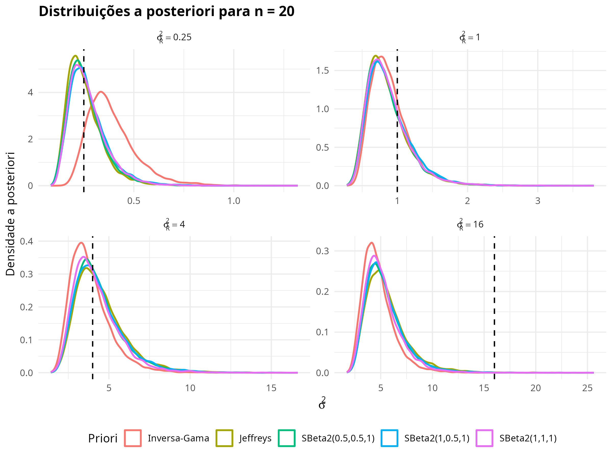
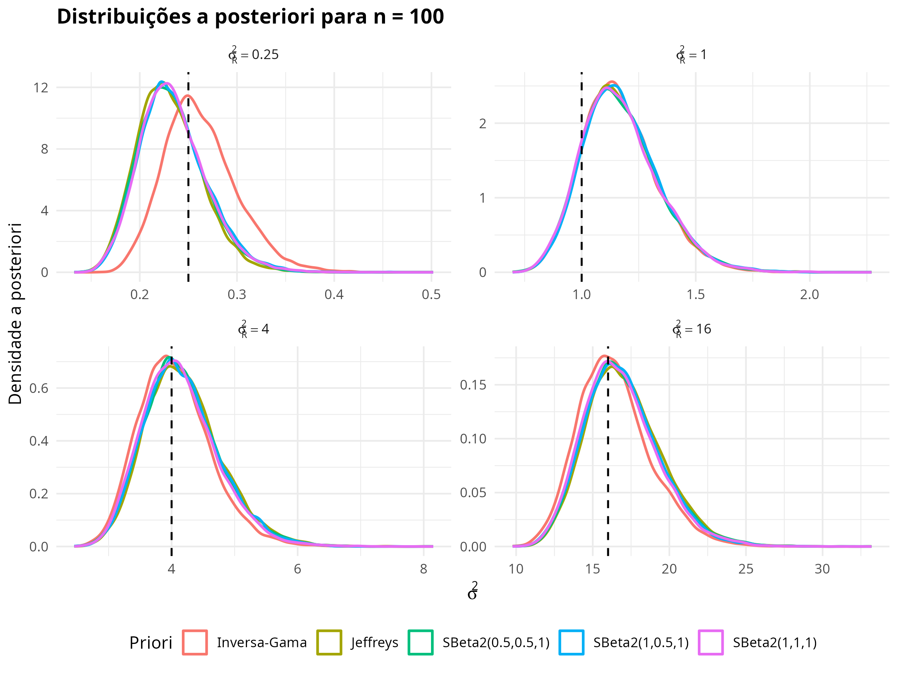
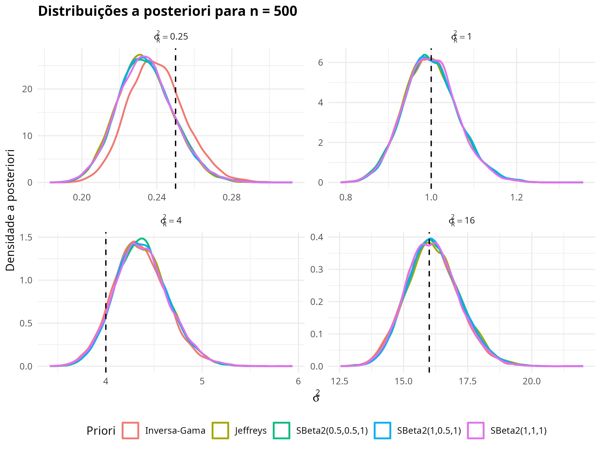

# Questão Extra

Considere uma amostra aleatória

$$
X_1,\ldots,X_n \mid \sigma^2
\overset{\text{iid}}{\sim}
N(0,\sigma^2).
$$

A densidade de cada observação é

$$
f(x_i\mid\sigma^2)
=
\frac{1}{\sqrt{2\pi\sigma^2}}
\exp\left\{
-\frac{x_i^2}{2\sigma^2}
\right\}.
$$

Como $X_1,\ldots,X_n$ são condicionalmente independentes dado
$\sigma^2$, a função de verossimilhança é

$$
L(\sigma^2\mid\mathbf{x})
=
\prod_{i=1}^n
f(x_i\mid\sigma^2).
$$

Portanto,

$$
L(\sigma^2\mid\mathbf{x})
=
\prod_{i=1}^n
\left[
(2\pi\sigma^2)^{-1/2}
\exp\left\{
-\frac{x_i^2}{2\sigma^2}
\right\}
\right].
$$

Agrupando os termos,

$$
L(\sigma^2\mid\mathbf{x})
=
(2\pi\sigma^2)^{-n/2}
\exp\left\{
-\frac{1}{2\sigma^2}
\sum_{i=1}^n x_i^2
\right\}.
$$

Como $(2\pi)^{-n/2}$ não depende de $\sigma^2$, o núcleo da
verossimilhança é

$$
L(\sigma^2\mid\mathbf{x})
\propto
(\sigma^2)^{-n/2}
\exp\left\{
-\frac{1}{2\sigma^2}
\sum_{i=1}^n x_i^2
\right\}.
$$


### Família conjugada natural para $\sigma^2$

Observando o núcleo da verossimilhança,

$$
L(\sigma^2\mid\mathbf{x})
\propto
(\sigma^2)^{-n/2}
\exp\left\{
-\frac{1}{\sigma^2}
\left(
\frac{1}{2}\sum_{i=1}^n x_i^2
\right)
\right\},
$$

vemos que uma distribuição apropriada para a priori de $\sigma^2$
é a distribuição Gama Inversa.

Considere

$$
\sigma^2 \sim GI(\alpha,\beta),
$$

com densidade

$$
\pi(\sigma^2)
=
\frac{\beta^\alpha}{\Gamma(\alpha)}
(\sigma^2)^{-(\alpha+1)}
\exp\left\{
-\frac{\beta}{\sigma^2}
\right\},
\qquad \sigma^2>0.
$$

Desconsiderando termos que não dependem de $\sigma^2$,

$$
\pi(\sigma^2)
\propto
(\sigma^2)^{-(\alpha+1)}
\exp\left\{
-\frac{\beta}{\sigma^2}
\right\}.
$$

Pelo teorema de Bayes,

$$
\pi(\sigma^2\mid\mathbf{x})
\propto
L(\sigma^2\mid\mathbf{x})\pi(\sigma^2).
$$

Substituindo os núcleos,

$$
\pi(\sigma^2\mid\mathbf{x})
\propto
(\sigma^2)^{-n/2}
\exp\left\{
-\frac{1}{2\sigma^2}
\sum_{i=1}^n x_i^2
\right\}
(\sigma^2)^{-(\alpha+1)}
\exp\left\{
-\frac{\beta}{\sigma^2}
\right\}.
$$

Agrupando as potências de $\sigma^2$,

$$
(\sigma^2)^{-n/2}
(\sigma^2)^{-(\alpha+1)}
=
(\sigma^2)^{-\left(
\alpha+\frac{n}{2}+1
\right)}.
$$

Além disso,

$$
\exp\left\{
-\frac{1}{2\sigma^2}\sum_{i=1}^n x_i^2
\right\}
\exp\left\{
-\frac{\beta}{\sigma^2}
\right\}
$$

pode ser escrito como

$$
\exp\left\{
-\frac{1}{\sigma^2}
\left[
\beta+
\frac{1}{2}\sum_{i=1}^n x_i^2
\right]
\right\}.
$$

Logo,

$$
\pi(\sigma^2\mid\mathbf{x})
\propto
(\sigma^2)^{-\left(
\alpha+\frac{n}{2}+1
\right)}
\exp\left\{
-\frac{
\beta+\frac{1}{2}\sum_{i=1}^n x_i^2
}{\sigma^2}
\right\}.
$$

Reconhecemos novamente o núcleo de uma distribuição Gama Inversa.
Portanto,

$$
\boxed{
\sigma^2\mid\mathbf{x}
\sim
GI\left(
\alpha+\frac{n}{2},
\beta+\frac{1}{2}\sum_{i=1}^n x_i^2
\right)
}
$$

Assim, a família Gama Inversa é conjugada para $\sigma^2$ nesse
modelo.


### Priori de Jeffreys para $\sigma^2$

A priori de Jeffreys é definida por

$$
\pi_J(\sigma^2)
\propto
\sqrt{I(\sigma^2)},
$$

em que $I(\sigma^2)$ é a informação de Fisher.

Partindo da função de verossimilhança,

$$
L(\sigma^2\mid\mathbf{x})
=
(2\pi\sigma^2)^{-n/2}
\exp\left\{
-\frac{1}{2\sigma^2}
\sum_{i=1}^n x_i^2
\right\},
$$

a log-verossimilhança é

$$
\ell(\sigma^2)
=
\log L(\sigma^2\mid\mathbf{x}).
$$

Assim,

$$
\ell(\sigma^2)
=
-\frac{n}{2}\log(2\pi)
-\frac{n}{2}\log(\sigma^2)
-\frac{1}{2\sigma^2}
\sum_{i=1}^n x_i^2.
$$

Derivando em relação a $\sigma^2$,

$$
\frac{\partial\ell(\sigma^2)}
{\partial\sigma^2}
=
-\frac{n}{2\sigma^2}
+
\frac{1}{2(\sigma^2)^2}
\sum_{i=1}^n x_i^2.
$$

Ou, equivalentemente,

$$
\frac{\partial\ell(\sigma^2)}
{\partial\sigma^2}
=
-\frac{n}{2\sigma^2}
+
\frac{1}{2\sigma^4}
\sum_{i=1}^n x_i^2.
$$

Derivando novamente,

$$
\frac{\partial^2\ell(\sigma^2)}
{\partial(\sigma^2)^2}
=
\frac{n}{2(\sigma^2)^2}
-
\frac{1}{(\sigma^2)^3}
\sum_{i=1}^n x_i^2.
$$

Portanto,

$$
\frac{\partial^2\ell(\sigma^2)}
{\partial(\sigma^2)^2}
=
\frac{n}{2\sigma^4}
-
\frac{\sum_{i=1}^n x_i^2}{\sigma^6}.
$$

A informação de Fisher é

$$
I(\sigma^2)
=
-
E\left[
\frac{\partial^2\ell(\sigma^2)}
{\partial(\sigma^2)^2}
\right].
$$

Como

$$
X_i\sim N(0,\sigma^2),
$$

temos

$$
E(X_i^2)
=
\operatorname{Var}(X_i)
+
[E(X_i)]^2.
$$

Como

$$
E(X_i)=0
$$

e

$$
\operatorname{Var}(X_i)=\sigma^2,
$$

segue que

$$
E(X_i^2)=\sigma^2.
$$

Consequentemente,

$$
E\left(
\sum_{i=1}^nX_i^2
\right)
=
\sum_{i=1}^nE(X_i^2)
=
n\sigma^2.
$$

Logo,

$$
I(\sigma^2)
=
-
\left[
\frac{n}{2\sigma^4}
-
\frac{n\sigma^2}{\sigma^6}
\right].
$$

Como

$$
\frac{n\sigma^2}{\sigma^6}
=
\frac{n}{\sigma^4},
$$

temos

$$
I(\sigma^2)
=
-
\left[
\frac{n}{2\sigma^4}
-
\frac{n}{\sigma^4}
\right].
$$

Portanto,

$$
I(\sigma^2)
=
\frac{n}{2\sigma^4}.
$$

A priori de Jeffreys é então

$$
\pi_J(\sigma^2)
\propto
\sqrt{
\frac{n}{2\sigma^4}
}.
$$

Como $\sqrt{n/2}$ é constante em relação a $\sigma^2$,

$$
\boxed{
\pi_J(\sigma^2)
\propto
\frac{1}{\sigma^2}
}
$$

para $\sigma^2>0$.

Agora calculamos a posteriori:

$$
\pi(\sigma^2\mid\mathbf{x})
\propto
L(\sigma^2\mid\mathbf{x})
\pi_J(\sigma^2).
$$

Assim,

$$
\pi(\sigma^2\mid\mathbf{x})
\propto
(\sigma^2)^{-n/2}
\exp\left\{
-\frac{1}{2\sigma^2}
\sum_{i=1}^n x_i^2
\right\}
(\sigma^2)^{-1}.
$$

Agrupando as potências,

$$
\pi(\sigma^2\mid\mathbf{x})
\propto
(\sigma^2)^{-\left(\frac{n}{2}+1\right)}
\exp\left\{
-\frac{
\frac{1}{2}\sum_{i=1}^n x_i^2
}{\sigma^2}
\right\}.
$$

Esse é o núcleo de uma distribuição Gama Inversa. Portanto,

$$
\boxed{
\sigma^2\mid\mathbf{x}
\sim
GI\left(
\frac{n}{2},
\frac{1}{2}\sum_{i=1}^n x_i^2
\right)
}
$$

### Priori Beta Escalada tipo 2 para $\sigma^2$

Considere

$$
\sigma^2 \sim SBeta2(p,q,b).
$$

Segundo Pérez, Pericchi e Ramírez (2017), a densidade da distribuição
Scaled Beta2 é

$$
\pi(\sigma^2)
=
\frac{\Gamma(p+q)}
{\Gamma(p)\Gamma(q)b}
\frac{
\left(\frac{\sigma^2}{b}\right)^{p-1}
}{
\left(1+\frac{\sigma^2}{b}\right)^{p+q}
},
$$

para

$$
\sigma^2>0,\qquad p>0,\qquad q>0,\qquad b>0.
$$

Como estamos interessados no núcleo da priori em relação a $\sigma^2$,

$$
\pi(\sigma^2)
\propto
\left(\frac{\sigma^2}{b}\right)^{p-1}
\left(1+\frac{\sigma^2}{b}\right)^{-(p+q)}.
$$

Temos

$$
\left(\frac{\sigma^2}{b}\right)^{p-1}
=
\frac{(\sigma^2)^{p-1}}{b^{p-1}}.
$$

Como $b^{p-1}$ não depende de $\sigma^2$,

$$
\pi(\sigma^2)
\propto
(\sigma^2)^{p-1}
\left(1+\frac{\sigma^2}{b}\right)^{-(p+q)}.
$$

A verossimilhança do modelo

$$
X_i\mid\sigma^2 \sim N(0,\sigma^2)
$$

é

$$
L(\sigma^2\mid\mathbf{x})
=
\prod_{i=1}^n
\frac{1}{\sqrt{2\pi\sigma^2}}
\exp\left\{
-\frac{x_i^2}{2\sigma^2}
\right\}.
$$

Portanto,

$$
L(\sigma^2\mid\mathbf{x})
=
(2\pi\sigma^2)^{-n/2}
\exp\left\{
-\frac{1}{2\sigma^2}
\sum_{i=1}^n x_i^2
\right\}.
$$

Desconsiderando os termos constantes em relação a $\sigma^2$,

$$
L(\sigma^2\mid\mathbf{x})
\propto
(\sigma^2)^{-n/2}
\exp\left\{
-\frac{1}{2\sigma^2}
\sum_{i=1}^n x_i^2
\right\}.
$$

Pelo teorema de Bayes,

$$
\pi(\sigma^2\mid\mathbf{x})
\propto
L(\sigma^2\mid\mathbf{x})\pi(\sigma^2).
$$

Substituindo os núcleos,

$$
\pi(\sigma^2\mid\mathbf{x})
\propto
(\sigma^2)^{-n/2}
\exp\left\{
-\frac{1}{2\sigma^2}
\sum_{i=1}^n x_i^2
\right\}
(\sigma^2)^{p-1}
\left(1+\frac{\sigma^2}{b}\right)^{-(p+q)}.
$$

Agrupando as potências de $\sigma^2$,

$$
(\sigma^2)^{-n/2}
(\sigma^2)^{p-1}
=
(\sigma^2)^{p-\frac{n}{2}-1}.
$$

Logo,

$$
\pi(\sigma^2\mid\mathbf{x})
\propto
(\sigma^2)^{p-\frac{n}{2}-1}
\left(1+\frac{\sigma^2}{b}\right)^{-(p+q)}
\exp\left\{
-\frac{1}{2\sigma^2}
\sum_{i=1}^n x_i^2
\right\}.
$$

Podemos ainda simplificar o termo da SBeta2. Como

$$
1+\frac{\sigma^2}{b}
=
\frac{\sigma^2+b}{b},
$$

temos

$$
\left(1+\frac{\sigma^2}{b}\right)^{-(p+q)}
=
\left(\frac{\sigma^2+b}{b}\right)^{-(p+q)}
=
\frac{b^{p+q}}{(\sigma^2+b)^{p+q}}.
$$

Como $b^{p+q}$ é constante em relação a $\sigma^2$,

$$
\left(1+\frac{\sigma^2}{b}\right)^{-(p+q)}
\propto
\frac{1}{(\sigma^2+b)^{p+q}}.
$$

Portanto, a posteriori pode ser escrita de forma equivalente como

$$
\boxed{
\pi(\sigma^2\mid\mathbf{x})
\propto
\frac{
(\sigma^2)^{p-\frac{n}{2}-1}
}{
(\sigma^2+b)^{p+q}
}
\exp\left\{
-\frac{\sum_{i=1}^n x_i^2}{2\sigma^2}
\right\}
}
$$

para $\sigma^2>0$.

Essa posteriori não pertence novamente, em geral, à família $SBeta2$,
pois a distribuição $SBeta2$ não é conjugada para este modelo normal.

## Implementação dos modelos no Stan

Os modelos considerados nos itens (i), (ii) e (iii) foram implementados no
Stan. Em todos os casos, considerou-se o modelo amostral

$$
X_i \mid \sigma^2 \overset{iid}{\sim} N(0,\sigma^2),
\qquad i=1,\ldots,n.
$$

A diferença entre os modelos está, portanto, apenas na distribuição a priori
atribuída à variância $\sigma^2$.

Foram considerados três casos:

1. priori conjugada Inversa-Gama;
2. priori de Jeffreys;
3. priori Beta Escalada tipo 2, $SBeta2$.

A implementação completa utilizada para gerar as amostras, ajustar os modelos
e extrair os resultados a posteriori é apresentada no **Anexo A**.

### Modelo com priori Inversa-Gama

No item (i), considerou-se

$$
\sigma^2 \sim IG(\alpha,\beta).
$$

O arquivo Stan utilizado foi:

```stan
data {
  int<lower=1> n;
  vector[n] x;
  real<lower=0> alpha;
  real<lower=0> beta;
}

parameters {
  real<lower=0> sigma2;
}

model {
  sigma2 ~ inv_gamma(alpha, beta);

  x ~ normal(0, sqrt(sigma2));
}
```

Neste caso, como a priori Inversa-Gama é conjugada para a variância de uma
distribuição Normal com média conhecida, a distribuição a posteriori possui
forma analítica conhecida. Dessa maneira, os resultados obtidos por MCMC
podem ser comparados diretamente com os resultados analíticos.

### Modelo com priori de Jeffreys

No item (ii), a priori de Jeffreys encontrada para $\sigma^2$ foi

$$
\pi(\sigma^2)
\propto
\frac{1}{\sigma^2}.
$$

Como essa priori é imprópria, ela foi implementada diretamente por meio da
contribuição de sua log-densidade ao `target` do Stan:

```stan
data {
  int<lower=1> n;
  vector[n] x;
}

parameters {
  real<lower=0> sigma2;
}

model {
  target += -log(sigma2);

  x ~ normal(0, sqrt(sigma2));
}
```

Nesse caso, apesar de a priori ser imprópria, a distribuição a posteriori
possui forma conhecida para o modelo considerado, permitindo novamente a
comparação entre os resultados analíticos e aqueles obtidos via MCMC.

### Modelo com priori Beta Escalada tipo 2

No item (iii), considerou-se diretamente para a variância

$$
\sigma^2 \sim SBeta2(p,q,b).
$$

Segundo Pérez, Pericchi e Ramírez (2017), a densidade da distribuição
Beta Escalada tipo 2 é

$$
\pi(\sigma^2)
=
\frac{\Gamma(p+q)}
{\Gamma(p)\Gamma(q)b}
\frac{
\left(\frac{\sigma^2}{b}\right)^{p-1}
}{
\left(1+\frac{\sigma^2}{b}\right)^{p+q}
}.
$$

A implementação foi:

```stan
functions {
  real sbeta2_lpdf(real x, real p, real q, real b) {
    return lgamma(p + q)
           - lgamma(p)
           - lgamma(q)
           - log(b)
           + (p - 1) * log(x / b)
           - (p + q) * log1p(x / b);
  }
}

data {
  int<lower=1> n;
  vector[n] x;

  real<lower=0> p;
  real<lower=0> q;
  real<lower=0> b;
}

parameters {
  real<lower=0> sigma2;
}

model {
  // Priori SBeta2
  sigma2 ~ sbeta2(p, q, b);

  // Verossimilhanca
  x ~ normal(0, sqrt(sigma2));
}

```

Diferentemente da Inversa-Gama, a priori $SBeta2$ não é conjugada para o
modelo considerado. Portanto, a distribuição a posteriori não pertence,
em geral, a uma família de distribuições conhecida. Nesse caso, a inferência
é realizada numericamente a partir das amostras geradas pelo Stan.

##  Estudo de simulação

Para avaliar o comportamento das distribuições a priori consideradas nos
itens anteriores, foram geradas amostras independentes segundo

$$
X_i \sim N(0,\sigma_R^2),
\qquad i=1,\ldots,n,
$$

em que $\sigma_R^2$ representa a variância utilizada na geração dos
dados.

Foram considerados três tamanhos amostrais,

$$
n\in\{20,100,500\},
$$

e quatro valores para a variância verdadeira,

$$
\sigma_R^2\in\{0.25,1,4,16\}.
$$

Em cada cenário foram ajustados cinco modelos, correspondentes às
seguintes distribuições a priori para $\sigma^2$:

$$
IG(2,2),
\qquad
\pi_J(\sigma^2)\propto\frac{1}{\sigma^2},
$$

e

$$
SBeta2(1,1,1),\qquad
SBeta2(0.5,0.5,1),\qquad
SBeta2(1,0.5,1).
$$

Os modelos foram ajustados no Stan utilizando quatro cadeias com
4.000 iterações cada, das quais 1.000 foram utilizadas como
\textit{warm-up}, resultando em 12.000 amostras a posteriori.

Para as prioris Inversa-Gama e de Jeffreys, a distribuição a
posteriori possui forma analítica conhecida. Dessa maneira, foi
possível comparar diretamente a média, a mediana e a moda calculadas
analiticamente com as estimativas obtidas a partir das amostras do
Stan.

Para a priori SBeta2, a distribuição a posteriori não pertence, em
geral, a uma família conhecida. Assim, suas medidas resumo foram
obtidas numericamente a partir das amostras a posteriori.

O código completo utilizado para geração das amostras, ajuste dos modelos,
execução do Stan e obtenção dos resumos a posteriori é apresentado no
**Anexo A**.

### Comparação com os resultados analíticos

Para as prioris Inversa-Gama e de Jeffreys, a distribuição a posteriori possui forma analítica conhecida. Assim, as medidas obtidas analiticamente foram comparadas às estimativas produzidas pelo Stan. Foram consideradas as combinações de tamanhos amostrais $n\in\{20,100,500\}$ e variâncias verdadeiras $\sigma_R^2\in\{0.25,1,4,16\}$. Na tabela, A representa o resultado analítico.

| $n$ | $\sigma_R^2$ | Priori | Distribuição a posteriori | Média (A / Stan) | Mediana (A / Stan) | Moda (A / Stan) |
|---:|---:|:---|:---|:---:|:---:|:---:|
| 20 | 0.25 | Inversa-Gama | $IG(12,4.297)$ | 0.391 / 0.389 | 0.368 / 0.366 | 0.331 / 0.335 |
| 20 | 0.25 | Jeffreys | $IG(10,2.297)$ | 0.255 / 0.256 | 0.238 / 0.238 | 0.209 / 0.209 |
| 20 | 1 | Inversa-Gama | -- | 0.890 / 0.895 | 0.839 / 0.844 | 0.753 / 0.776 |
| 20 | 1 | Jeffreys | -- | 0.865 / 0.860 | 0.806 / 0.799 | 0.708 / 0.690 |
| 20 | 4 | Inversa-Gama | $IG(12,42.357)$ | 3.851 / 3.856 | 3.630 / 3.614 | 3.258 / 3.296 |
| 20 | 4 | Jeffreys | $IG(10,40.357)$ | 4.484 / 4.494 | 4.174 / 4.198 | 3.669 / 3.604 |
| 20 | 16 | Inversa-Gama | $IG(12,52)$ | 4.727 / 4.768 | 4.457 / 4.492 | 4.000 / 4.113 |
| 20 | 16 | Jeffreys | $IG(10,50)$ | 5.556 / 5.590 | 5.171 / 5.183 | 4.545 / 4.813 |
| 100 | 0.25 | Inversa-Gama | $IG(52,13.31)$ | 0.261 / 0.262 | 0.258 / 0.258 | 0.251 / 0.249 |
| 100 | 0.25 | Jeffreys | $IG(50,11.31)$ | 0.231 / 0.231 | 0.228 / 0.228 | 0.222 / 0.223 |
| 100 | 1 | Inversa-Gama | $IG(52,59.414)$ | 1.165 / 1.167 | 1.150 / 1.151 | 1.121 / 1.133 |
| 100 | 1 | Jeffreys | $IG(50,57.414)$ | 1.172 / 1.172 | 1.156 / 1.154 | 1.126 / 1.111 |
| 100 | 4 | Inversa-Gama | $IG(52,206.916)$ | 4.057 / 4.054 | 4.005 / 4.007 | 3.904 / 3.918 |
| 100 | 4 | Jeffreys | $IG(50,204.916)$ | 4.182 / 4.198 | 4.126 / 4.144 | 4.018 / 3.981 |
| 100 | 16 | Inversa-Gama | $IG(52,839.049)$ | 16.452 / 16.425 | 16.240 / 16.210 | 15.831 / 15.755 |
| 100 | 16 | Jeffreys | $IG(50,837.049)$ | 17.083 / 17.094 | 16.853 / 16.856 | 16.413 / 16.251 |
| 500 | 0.25 | Inversa-Gama | $IG(252,60.225)$ | 0.240 / 0.240 | 0.239 / 0.239 | 0.238 / 0.236 |
| 500 | 0.25 | Jeffreys | $IG(250,58.225)$ | 0.234 / 0.234 | 0.233 / 0.233 | 0.232 / 0.231 |
| 500 | 1 | Inversa-Gama | $IG(252,250.98)$ | 1.000 / 0.999 | 0.997 / 0.997 | 0.992 / 0.988 |
| 500 | 1 | Jeffreys | $IG(250,248.98)$ | 1.000 / 0.999 | 0.997 / 0.996 | 0.992 / 1.001 |
| 500 | 4 | Inversa-Gama | $IG(252,1093.227)$ | 4.355 / 4.354 | 4.344 / 4.340 | 4.321 / 4.296 |
| 500 | 4 | Jeffreys | $IG(250,1091.227)$ | 4.382 / 4.380 | 4.371 / 4.365 | 4.348 / 4.269 |
| 500 | 16 | Inversa-Gama | $IG(252,4038.905)$ | 16.091 / 16.097 | 16.049 / 16.060 | 15.964 / 16.020 |
| 500 | 16 | Jeffreys | $IG(250,4036.905)$ | 16.212 / 16.207 | 16.169 / 16.152 | 16.083 / 15.975 |

: Comparação entre os resultados analíticos (A) e as estimativas obtidas via Stan para as prioris Inversa-Gama e de Jeffreys. {#tbl-analitico-stan}

Os resultados mostram boa concordância entre as medidas obtidas analiticamente e aquelas estimadas a partir das amostras geradas pelo Stan. Em todos os tamanhos amostrais, as diferenças observadas para a média e a mediana foram pequenas. Para a moda, verificaram-se algumas diferenças ligeiramente maiores, o que pode estar relacionado ao fato de essa medida ter sido estimada numericamente a partir das amostras a posteriori.

De maneira geral, a proximidade entre os resultados analíticos e numéricos fornece uma verificação da implementação dos modelos no Stan. Essa concordância torna-se particularmente evidente nos cenários com $n=500$, nos quais as estimativas obtidas pelos dois procedimentos são praticamente coincidentes para a média e a mediana.

### Comparação das distribuições a posteriori

As Figuras @fig-post20, @fig-post100 e @fig-post500 apresentam as distribuições a posteriori de $\sigma^2$ obtidas sob as diferentes prioris. A linha vertical tracejada representa o verdadeiro valor de $\sigma_R^2$ utilizado na geração dos dados.

{#fig-post20 width=90%}

{#fig-post100 width=90%}

{#fig-post500 width=90%}

### Resultados para a priori SBeta2

Para a priori Beta Escalada tipo 2, a distribuição a posteriori não pertence, em geral, a uma família conhecida. Dessa forma, as medidas resumo foram obtidas numericamente a partir das amostras geradas pelo Stan. Foram consideradas as especificações $SBeta2(1,1,1)$, $SBeta2(0.5,0.5,1)$ e $SBeta2(1,0.5,1)$.

| $n$ | $\sigma_R^2$ | Priori | Média | Mediana | Moda | IC 95% |
|---:|---:|:---|---:|---:|---:|:---:|
| 20 | 0.25 | $SBeta2(1,1,1)$ | 0.271 | 0.252 | 0.215 | [0.14, 0.50] |
| 20 | 0.25 | $SBeta2(0.5,0.5,1)$ | 0.263 | 0.245 | 0.219 | [0.13, 0.50] |
| 20 | 0.25 | $SBeta2(1,0.5,1)$ | 0.275 | 0.255 | 0.236 | [0.14, 0.52] |
| 20 | 1 | $SBeta2(1,1,1)$ | 0.870 | 0.811 | 0.719 | [0.46, 1.62] |
| 20 | 1 | $SBeta2(0.5,0.5,1)$ | 0.865 | 0.806 | 0.719 | [0.45, 1.64] |
| 20 | 1 | $SBeta2(1,0.5,1)$ | 0.890 | 0.828 | 0.715 | [0.47, 1.65] |
| 20 | 4 | $SBeta2(1,1,1)$ | 4.213 | 3.936 | 3.440 | [2.28, 7.64] |
| 20 | 4 | $SBeta2(0.5,0.5,1)$ | 4.356 | 4.067 | 3.604 | [2.31, 8.10] |
| 20 | 4 | $SBeta2(1,0.5,1)$ | 4.397 | 4.095 | 3.694 | [2.31, 8.14] |
| 20 | 16 | $SBeta2(1,1,1)$ | 5.174 | 4.857 | 4.378 | [2.76, 9.33] |
| 20 | 16 | $SBeta2(0.5,0.5,1)$ | 5.383 | 5.008 | 4.423 | [2.86, 10.07] |
| 20 | 16 | $SBeta2(1,0.5,1)$ | 5.412 | 5.038 | 4.552 | [2.86, 10.07] |

: Resultados a posteriori obtidos via Stan para as prioris SBeta2 com $n=20$. {#tbl-sbeta20}

| $n$ | $\sigma_R^2$ | Priori | Média | Mediana | Moda | IC 95% |
|---:|---:|:---|---:|---:|---:|:---:|
| 500 | 0.25 | $SBeta2(1,1,1)$ | 0.234 | 0.234 | 0.233 | [0.21, 0.27] |
| 500 | 0.25 | $SBeta2(0.5,0.5,1)$ | 0.234 | 0.233 | 0.231 | [0.21, 0.27] |
| 500 | 0.25 | $SBeta2(1,0.5,1)$ | 0.234 | 0.233 | 0.233 | [0.21, 0.27] |
| 500 | 1 | $SBeta2(1,1,1)$ | 0.999 | 0.997 | 0.984 | [0.88, 1.13] |
| 500 | 1 | $SBeta2(0.5,0.5,1)$ | 1.000 | 0.997 | 0.985 | [0.88, 1.14] |
| 500 | 1 | $SBeta2(1,0.5,1)$ | 1.001 | 0.998 | 0.981 | [0.88, 1.14] |
| 500 | 4 | $SBeta2(1,1,1)$ | 4.373 | 4.361 | 4.289 | [3.85, 4.96] |
| 500 | 4 | $SBeta2(0.5,0.5,1)$ | 4.378 | 4.368 | 4.375 | [3.87, 4.96] |
| 500 | 4 | $SBeta2(1,0.5,1)$ | 4.378 | 4.366 | 4.309 | [3.87, 4.97] |
| 500 | 16 | $SBeta2(1,1,1)$ | 16.134 | 16.089 | 16.217 | [14.26, 18.28] |
| 500 | 16 | $SBeta2(0.5,0.5,1)$ | 16.172 | 16.114 | 16.017 | [14.26, 18.34] |
| 500 | 16 | $SBeta2(1,0.5,1)$ | 16.197 | 16.140 | 16.056 | [14.32, 18.35] |

: Resultados a posteriori obtidos via Stan para as prioris SBeta2 com $n=500$. {#tbl-sbeta500}

| $n$ | $\sigma_R^2$ | Priori | Média | Mediana | Moda | IC 95% |
|---:|---:|:---|---:|---:|---:|:---:|
| 500 | 0.25 | $SBeta2(1,1,1)$ | 0.234 | 0.234 | 0.233 | [0.21, 0.27] |
| 500 | 0.25 | $SBeta2(0.5,0.5,1)$ | 0.234 | 0.233 | 0.231 | [0.21, 0.27] |
| 500 | 0.25 | $SBeta2(1,0.5,1)$ | 0.234 | 0.233 | 0.233 | [0.21, 0.27] |
| 500 | 1 | $SBeta2(1,1,1)$ | 0.999 | 0.997 | 0.984 | [0.88, 1.13] |
| 500 | 1 | $SBeta2(0.5,0.5,1)$ | 1.000 | 0.997 | 0.985 | [0.88, 1.14] |
| 500 | 1 | $SBeta2(1,0.5,1)$ | 1.001 | 0.998 | 0.981 | [0.88, 1.14] |
| 500 | 4 | $SBeta2(1,1,1)$ | 4.373 | 4.361 | 4.289 | [3.85, 4.96] |
| 500 | 4 | $SBeta2(0.5,0.5,1)$ | 4.378 | 4.368 | 4.375 | [3.87, 4.96] |
| 500 | 4 | $SBeta2(1,0.5,1)$ | 4.378 | 4.366 | 4.309 | [3.87, 4.97] |
| 500 | 16 | $SBeta2(1,1,1)$ | 16.134 | 16.089 | 16.217 | [14.26, 18.28] |
| 500 | 16 | $SBeta2(0.5,0.5,1)$ | 16.172 | 16.114 | 16.017 | [14.26, 18.34] |
| 500 | 16 | $SBeta2(1,0.5,1)$ | 16.197 | 16.140 | 16.056 | [14.32, 18.35] |

: Resultados a posteriori obtidos via Stan para as prioris SBeta2 com $n=500$. {#tbl-sbeta500}

Observa-se que as diferenças entre as três especificações da SBeta2 são mais perceptíveis para $n=20$. Para os cenários com menor tamanho amostral, a escolha dos hiperparâmetros $p$ e $q$ produz diferenças nas medidas de tendência central e na amplitude dos intervalos de credibilidade. Entretanto, mesmo nesse caso, as três especificações apresentam resultados relativamente próximos entre si.

Com o aumento do tamanho amostral, as diferenças entre as prioris diminuem. Para $n=100$, as médias e medianas obtidas sob as três especificações da SBeta2 já apresentam valores bastante semelhantes. Para $n=500$, os resultados são praticamente coincidentes nos diferentes cenários, tanto em relação às medidas de tendência central quanto aos intervalos de credibilidade.

Esse comportamento indica que a influência da escolha dos hiperparâmetros da SBeta2 é maior quando há menos informação amostral. À medida que $n$ aumenta, a contribuição da verossimilhança passa a dominar a distribuição a posteriori, reduzindo a influência da especificação da priori.

## Comparação entre a priori conjugada e a SBeta2

A principal limitação da SBeta2 neste problema é a ausência de conjugação. Como destacam Pérez, Pericchi e Ramírez (2017), ao assumir

$$
\sigma^2 \sim SBeta2(p,q,b),
$$

a distribuição a posteriori de $\sigma^2$ não pertence, em geral, novamente à família SBeta2. Isso contrasta com a priori Inversa-Gama, que é conjugada no modelo Normal e permite obter a posteriori e suas medidas resumo de forma analítica.

Na prática, essa diferença torna a SBeta2 mais dependente de métodos computacionais, como MCMC, para estimar média, mediana, moda e intervalos de credibilidade. Já no caso conjugado, essas quantidades podem ser obtidas diretamente.

Apesar dessa limitação, os resultados da simulação não indicaram pior desempenho da SBeta2. Para $n=100$ e $n=500$, as estimativas obtidas com a SBeta2 ficaram muito próximas das obtidas com a Inversa-Gama. As diferenças foram mais visíveis para $n=20$, quando a influência da priori é maior.

Assim, a ausência de conjugação representa principalmente uma desvantagem analítica e computacional. A Inversa-Gama é mais simples de trabalhar, enquanto a SBeta2 oferece maior flexibilidade na especificação da priori, sem apresentar diferenças relevantes nos resultados para amostras maiores.

Outra dificuldade da SBeta2 está na escolha dos hiperparâmetros $p$ e $q$. A influência dos hiperparâmetros $p$ e $q$ pode ser observada nos resultados obtidos para as diferentes especificações da SBeta2. Para $n=20$, as diferenças entre $SBeta2(1,1,1)$, $SBeta2(0.5,0.5,1)$ e $SBeta2(1,0.5,1)$ são mais perceptíveis, principalmente nas médias e modas a posteriori. Por exemplo, para $\sigma_R^2=4$, as médias foram aproximadamente $4.21$, $4.36$ e $4.40$, respectivamente, enquanto as modas variaram de aproximadamente $3.44$ a $3.69$.

Essas diferenças diminuem à medida que o tamanho amostral aumenta. Para $n=100$, os resultados das três especificações já são bastante próximos e, para $n=500$, tornam-se praticamente indistinguíveis em vários cenários. Por exemplo, com $\sigma_R^2=4$ e $n=500$, as médias a posteriori ficaram entre $4.37$ e $4.38$ para as três escolhas de $(p,q)$.

# Anexo A

```{r}
#| eval: false
#| echo: true
#| warning: false
#| message: false

library(rstan)      ## rodar MCMC
library(posterior)  ## funções para posteriori

options(mc.cores = parallel::detectCores())

rstan_options(auto_write = TRUE)


# Compilando modelos -----------------------------------------------------------

modelo_IG <- stan_model(
  file = "priori_IG.stan"
)

modelo_jeffreys <- stan_model(
  file = "priori_jeffreys.stan"
)

modelo_sbeta2 <- stan_model(
  file = "priori_sbeta2.stan"
)


# Parâmetros da priori Inversa-Gama -------------------------------------------

alpha <- 2
beta <- 2


# ==============================================================================
# n = 20
# ==============================================================================


# ------------------------------------------------------------------------------
# n = 20 e sigma_R^2 = 0.25
# ------------------------------------------------------------------------------

set.seed(123)

n <- 20
sigma2_real <- 0.25

x_n20_s025 <- rnorm(
  n = n,
  mean = 0,
  sd = sqrt(sigma2_real)
)


# Inversa-Gama -----------------------------------------------------------------

dados_IG_n20_s025 <- list(
  n = n,
  x = x_n20_s025,
  alpha = alpha,
  beta = beta
)

ajuste_IG_n20_s025 <- sampling(
  object = modelo_IG,
  data = dados_IG_n20_s025,
  chains = 4,
  iter = 4000,
  warmup = 1000,
  seed = 123
)


# Jeffreys ---------------------------------------------------------------------

dados_jeffreys_n20_s025 <- list(
  n = n,
  x = x_n20_s025
)

ajuste_jeffreys_n20_s025 <- sampling(
  object = modelo_jeffreys,
  data = dados_jeffreys_n20_s025,
  chains = 4,
  iter = 4000,
  warmup = 1000,
  seed = 123
)


# SBeta2(1, 1, 1) --------------------------------------------------------------

dados_sbeta2_111_n20_s025 <- list(
  n = n,
  x = x_n20_s025,
  p = 1,
  q = 1,
  b = 1
)

ajuste_sbeta2_111_n20_s025 <- sampling(
  object = modelo_sbeta2,
  data = dados_sbeta2_111_n20_s025,
  chains = 4,
  iter = 4000,
  warmup = 1000,
  seed = 123
)


# SBeta2(0.5, 0.5, 1) ----------------------------------------------------------

dados_sbeta2_0505_1_n20_s025 <- list(
  n = n,
  x = x_n20_s025,
  p = 0.5,
  q = 0.5,
  b = 1
)

ajuste_sbeta2_0505_1_n20_s025 <- sampling(
  object = modelo_sbeta2,
  data = dados_sbeta2_0505_1_n20_s025,
  chains = 4,
  iter = 4000,
  warmup = 1000,
  seed = 123
)


# SBeta2(1, 0.5, 1) ------------------------------------------------------------

dados_sbeta2_105_1_n20_s025 <- list(
  n = n,
  x = x_n20_s025,
  p = 1,
  q = 0.5,
  b = 1
)

ajuste_sbeta2_105_1_n20_s025 <- sampling(
  object = modelo_sbeta2,
  data = dados_sbeta2_105_1_n20_s025,
  chains = 4,
  iter = 4000,
  warmup = 1000,
  seed = 123
)

# ------------------------------------------------------------------------------
# n = 20 e sigma_R^2 = 1
# ------------------------------------------------------------------------------

set.seed(124)

n <- 20
sigma2_real <- 1

x_n20_s1 <- rnorm(
  n = n,
  mean = 0,
  sd = sqrt(sigma2_real)
)

dados_IG_n20_s1 <- list(
  n = n,
  x = x_n20_s1,
  alpha = alpha,
  beta = beta
)

ajuste_IG_n20_s1 <- sampling(
  object = modelo_IG,
  data = dados_IG_n20_s1,
  chains = 4,
  iter = 4000,
  warmup = 1000,
  seed = 123
)

dados_jeffreys_n20_s1 <- list(
  n = n,
  x = x_n20_s1
)

ajuste_jeffreys_n20_s1 <- sampling(
  object = modelo_jeffreys,
  data = dados_jeffreys_n20_s1,
  chains = 4,
  iter = 4000,
  warmup = 1000,
  seed = 123
)

dados_sbeta2_111_n20_s1 <- list(
  n = n,
  x = x_n20_s1,
  p = 1,
  q = 1,
  b = 1
)

ajuste_sbeta2_111_n20_s1 <- sampling(
  object = modelo_sbeta2,
  data = dados_sbeta2_111_n20_s1,
  chains = 4,
  iter = 4000,
  warmup = 1000,
  seed = 123
)

dados_sbeta2_0505_1_n20_s1 <- list(
  n = n,
  x = x_n20_s1,
  p = 0.5,
  q = 0.5,
  b = 1
)

ajuste_sbeta2_0505_1_n20_s1 <- sampling(
  object = modelo_sbeta2,
  data = dados_sbeta2_0505_1_n20_s1,
  chains = 4,
  iter = 4000,
  warmup = 1000,
  seed = 123
)

dados_sbeta2_105_1_n20_s1 <- list(
  n = n,
  x = x_n20_s1,
  p = 1,
  q = 0.5,
  b = 1
)

ajuste_sbeta2_105_1_n20_s1 <- sampling(
  object = modelo_sbeta2,
  data = dados_sbeta2_105_1_n20_s1,
  chains = 4,
  iter = 4000,
  warmup = 1000,
  seed = 123
)

# ------------------------------------------------------------------------------
# n = 20 e sigma_R^2 = 4
# ------------------------------------------------------------------------------

set.seed(125)

n <- 20
sigma2_real <- 4

x_n20_s4 <- rnorm(n, 0, sqrt(sigma2_real))

dados_IG_n20_s4 <- list(
  n = n,
  x = x_n20_s4,
  alpha = alpha,
  beta = beta
)

ajuste_IG_n20_s4 <- sampling(
  modelo_IG,
  data = dados_IG_n20_s4,
  chains = 4,
  iter = 4000,
  warmup = 1000,
  seed = 123
)

dados_jeffreys_n20_s4 <- list(
  n = n,
  x = x_n20_s4
)

ajuste_jeffreys_n20_s4 <- sampling(
  modelo_jeffreys,
  data = dados_jeffreys_n20_s4,
  chains = 4,
  iter = 4000,
  warmup = 1000,
  seed = 123
)

dados_sbeta2_111_n20_s4 <- list(
  n = n, x = x_n20_s4,
  p = 1, q = 1, b = 1
)

ajuste_sbeta2_111_n20_s4 <- sampling(
  modelo_sbeta2,
  data = dados_sbeta2_111_n20_s4,
  chains = 4,
  iter = 4000,
  warmup = 1000,
  seed = 123
)

dados_sbeta2_0505_1_n20_s4 <- list(
  n = n, x = x_n20_s4,
  p = 0.5, q = 0.5, b = 1
)

ajuste_sbeta2_0505_1_n20_s4 <- sampling(
  modelo_sbeta2,
  data = dados_sbeta2_0505_1_n20_s4,
  chains = 4,
  iter = 4000,
  warmup = 1000,
  seed = 123
)

dados_sbeta2_105_1_n20_s4 <- list(
  n = n, x = x_n20_s4,
  p = 1, q = 0.5, b = 1
)

ajuste_sbeta2_105_1_n20_s4 <- sampling(
  modelo_sbeta2,
  data = dados_sbeta2_105_1_n20_s4,
  chains = 4,
  iter = 4000,
  warmup = 1000,
  seed = 123
)

# ------------------------------------------------------------------------------
# n = 20 e sigma_R^2 = 16
# ------------------------------------------------------------------------------

set.seed(126)

n <- 20
sigma2_real <- 16

x_n20_s16 <- rnorm(n, 0, sqrt(sigma2_real))

dados_IG_n20_s16 <- list(
  n = n, x = x_n20_s16,
  alpha = alpha, beta = beta
)

ajuste_IG_n20_s16 <- sampling(
  modelo_IG,
  data = dados_IG_n20_s16,
  chains = 4,
  iter = 4000,
  warmup = 1000,
  seed = 123
)

dados_jeffreys_n20_s16 <- list(
  n = n,
  x = x_n20_s16
)

ajuste_jeffreys_n20_s16 <- sampling(
  modelo_jeffreys,
  data = dados_jeffreys_n20_s16,
  chains = 4,
  iter = 4000,
  warmup = 1000,
  seed = 123
)

dados_sbeta2_111_n20_s16 <- list(
  n = n, x = x_n20_s16,
  p = 1, q = 1, b = 1
)

ajuste_sbeta2_111_n20_s16 <- sampling(
  modelo_sbeta2,
  data = dados_sbeta2_111_n20_s16,
  chains = 4,
  iter = 4000,
  warmup = 1000,
  seed = 123
)

dados_sbeta2_0505_1_n20_s16 <- list(
  n = n, x = x_n20_s16,
  p = 0.5, q = 0.5, b = 1
)

ajuste_sbeta2_0505_1_n20_s16 <- sampling(
  modelo_sbeta2,
  data = dados_sbeta2_0505_1_n20_s16,
  chains = 4,
  iter = 4000,
  warmup = 1000,
  seed = 123
)

dados_sbeta2_105_1_n20_s16 <- list(
  n = n, x = x_n20_s16,
  p = 1, q = 0.5, b = 1
)

ajuste_sbeta2_105_1_n20_s16 <- sampling(
  modelo_sbeta2,
  data = dados_sbeta2_105_1_n20_s16,
  chains = 4,
  iter = 4000,
  warmup = 1000,
  seed = 123
)

# ==============================================================================
# n = 100
# ==============================================================================


# ------------------------------------------------------------------------------
# n = 100 e sigma_R^2 = 0.25
# ------------------------------------------------------------------------------

set.seed(127)

n <- 100
sigma2_real <- 0.25

x_n100_s025 <- rnorm(n, 0, sqrt(sigma2_real))

dados_IG_n100_s025 <- list(
  n = n, x = x_n100_s025,
  alpha = alpha, beta = beta
)

ajuste_IG_n100_s025 <- sampling(
  modelo_IG,
  data = dados_IG_n100_s025,
  chains = 4,
  iter = 4000,
  warmup = 1000,
  seed = 123
)

dados_jeffreys_n100_s025 <- list(
  n = n,
  x = x_n100_s025
)

ajuste_jeffreys_n100_s025 <- sampling(
  modelo_jeffreys,
  data = dados_jeffreys_n100_s025,
  chains = 4,
  iter = 4000,
  warmup = 1000,
  seed = 123
)

dados_sbeta2_111_n100_s025 <- list(
  n = n, x = x_n100_s025,
  p = 1, q = 1, b = 1
)

ajuste_sbeta2_111_n100_s025 <- sampling(
  modelo_sbeta2,
  data = dados_sbeta2_111_n100_s025,
  chains = 4,
  iter = 4000,
  warmup = 1000,
  seed = 123
)

dados_sbeta2_0505_1_n100_s025 <- list(
  n = n, x = x_n100_s025,
  p = 0.5, q = 0.5, b = 1
)

ajuste_sbeta2_0505_1_n100_s025 <- sampling(
  modelo_sbeta2,
  data = dados_sbeta2_0505_1_n100_s025,
  chains = 4,
  iter = 4000,
  warmup = 1000,
  seed = 123
)

dados_sbeta2_105_1_n100_s025 <- list(
  n = n, x = x_n100_s025,
  p = 1, q = 0.5, b = 1
)

ajuste_sbeta2_105_1_n100_s025 <- sampling(
  modelo_sbeta2,
  data = dados_sbeta2_105_1_n100_s025,
  chains = 4,
  iter = 4000,
  warmup = 1000,
  seed = 123
)


# ------------------------------------------------------------------------------
# n = 100 e sigma_R^2 = 1
# ------------------------------------------------------------------------------

set.seed(128)

n <- 100
sigma2_real <- 1

x_n100_s1 <- rnorm(n, 0, sqrt(sigma2_real))

dados_IG_n100_s1 <- list(n = n, x = x_n100_s1, alpha = alpha, beta = beta)

ajuste_IG_n100_s1 <- sampling(
  modelo_IG,
  data = dados_IG_n100_s1,
  chains = 4, iter = 4000, warmup = 1000,
  seed = 123
)

dados_jeffreys_n100_s1 <- list(n = n, x = x_n100_s1)

ajuste_jeffreys_n100_s1 <- sampling(
  modelo_jeffreys,
  data = dados_jeffreys_n100_s1,
  chains = 4, iter = 4000, warmup = 1000,
  seed = 123
)

dados_sbeta2_111_n100_s1 <- list(
  n = n, x = x_n100_s1,
  p = 1, q = 1, b = 1
)

ajuste_sbeta2_111_n100_s1 <- sampling(
  modelo_sbeta2,
  data = dados_sbeta2_111_n100_s1,
  chains = 4, iter = 4000, warmup = 1000,
  seed = 123
)

dados_sbeta2_0505_1_n100_s1 <- list(
  n = n, x = x_n100_s1,
  p = 0.5, q = 0.5, b = 1
)

ajuste_sbeta2_0505_1_n100_s1 <- sampling(
  modelo_sbeta2,
  data = dados_sbeta2_0505_1_n100_s1,
  chains = 4, iter = 4000, warmup = 1000,
  seed = 123
)

dados_sbeta2_105_1_n100_s1 <- list(
  n = n, x = x_n100_s1,
  p = 1, q = 0.5, b = 1
)

ajuste_sbeta2_105_1_n100_s1 <- sampling(
  modelo_sbeta2,
  data = dados_sbeta2_105_1_n100_s1,
  chains = 4, iter = 4000, warmup = 1000,
  seed = 123
)

dados_sbeta2_111_05_n100_s1 <- list(
  n = n, x = x_n100_s1,
  p = 1, q = 1, b = 0.5
)

ajuste_sbeta2_111_05_n100_s1 <- sampling(
  modelo_sbeta2,
  data = dados_sbeta2_111_05_n100_s1,
  chains = 4, iter = 4000, warmup = 1000,
  seed = 123
)

dados_sbeta2_111_2_n100_s1 <- list(
  n = n, x = x_n100_s1,
  p = 1, q = 1, b = 2
)

ajuste_sbeta2_111_2_n100_s1 <- sampling(
  modelo_sbeta2,
  data = dados_sbeta2_111_2_n100_s1,
  chains = 4, iter = 4000, warmup = 1000,
  seed = 123
)


# ------------------------------------------------------------------------------
# n = 100 e sigma_R^2 = 4
# ------------------------------------------------------------------------------

set.seed(129)

n <- 100
sigma2_real <- 4

x_n100_s4 <- rnorm(n, 0, sqrt(sigma2_real))

dados_IG_n100_s4 <- list(n = n, x = x_n100_s4, alpha = alpha, beta = beta)

ajuste_IG_n100_s4 <- sampling(
  modelo_IG,
  data = dados_IG_n100_s4,
  chains = 4, iter = 4000, warmup = 1000,
  seed = 123
)

dados_jeffreys_n100_s4 <- list(n = n, x = x_n100_s4)

ajuste_jeffreys_n100_s4 <- sampling(
  modelo_jeffreys,
  data = dados_jeffreys_n100_s4,
  chains = 4, iter = 4000, warmup = 1000,
  seed = 123
)

dados_sbeta2_111_n100_s4 <- list(
  n = n, x = x_n100_s4,
  p = 1, q = 1, b = 1
)

ajuste_sbeta2_111_n100_s4 <- sampling(
  modelo_sbeta2,
  data = dados_sbeta2_111_n100_s4,
  chains = 4, iter = 4000, warmup = 1000,
  seed = 123
)

dados_sbeta2_0505_1_n100_s4 <- list(
  n = n, x = x_n100_s4,
  p = 0.5, q = 0.5, b = 1
)

ajuste_sbeta2_0505_1_n100_s4 <- sampling(
  modelo_sbeta2,
  data = dados_sbeta2_0505_1_n100_s4,
  chains = 4, iter = 4000, warmup = 1000,
  seed = 123
)

dados_sbeta2_105_1_n100_s4 <- list(
  n = n, x = x_n100_s4,
  p = 1, q = 0.5, b = 1
)

ajuste_sbeta2_105_1_n100_s4 <- sampling(
  modelo_sbeta2,
  data = dados_sbeta2_105_1_n100_s4,
  chains = 4, iter = 4000, warmup = 1000,
  seed = 123
)

# ------------------------------------------------------------------------------
# n = 100 e sigma_R^2 = 16
# ------------------------------------------------------------------------------

set.seed(130)

n <- 100
sigma2_real <- 16

x_n100_s16 <- rnorm(n, 0, sqrt(sigma2_real))

dados_IG_n100_s16 <- list(n = n, x = x_n100_s16, alpha = alpha, beta = beta)

ajuste_IG_n100_s16 <- sampling(
  modelo_IG,
  data = dados_IG_n100_s16,
  chains = 4, iter = 4000, warmup = 1000,
  seed = 123
)

dados_jeffreys_n100_s16 <- list(n = n, x = x_n100_s16)

ajuste_jeffreys_n100_s16 <- sampling(
  modelo_jeffreys,
  data = dados_jeffreys_n100_s16,
  chains = 4, iter = 4000, warmup = 1000,
  seed = 123
)

dados_sbeta2_111_n100_s16 <- list(
  n = n, x = x_n100_s16,
  p = 1, q = 1, b = 1
)

ajuste_sbeta2_111_n100_s16 <- sampling(
  modelo_sbeta2,
  data = dados_sbeta2_111_n100_s16,
  chains = 4, iter = 4000, warmup = 1000,
  seed = 123
)

dados_sbeta2_0505_1_n100_s16 <- list(
  n = n, x = x_n100_s16,
  p = 0.5, q = 0.5, b = 1
)

ajuste_sbeta2_0505_1_n100_s16 <- sampling(
  modelo_sbeta2,
  data = dados_sbeta2_0505_1_n100_s16,
  chains = 4, iter = 4000, warmup = 1000,
  seed = 123
)

dados_sbeta2_105_1_n100_s16 <- list(
  n = n, x = x_n100_s16,
  p = 1, q = 0.5, b = 1
)

ajuste_sbeta2_105_1_n100_s16 <- sampling(
  modelo_sbeta2,
  data = dados_sbeta2_105_1_n100_s16,
  chains = 4, iter = 4000, warmup = 1000,
  seed = 123
)

# ==============================================================================
# n = 500
# ==============================================================================


# ------------------------------------------------------------------------------
# n = 500 e sigma_R^2 = 0.25
# ------------------------------------------------------------------------------

set.seed(131)

n <- 500
sigma2_real <- 0.25

x_n500_s025 <- rnorm(n, 0, sqrt(sigma2_real))

dados_IG_n500_s025 <- list(n = n, x = x_n500_s025, alpha = alpha, beta = beta)

ajuste_IG_n500_s025 <- sampling(
  modelo_IG,
  data = dados_IG_n500_s025,
  chains = 4, iter = 4000, warmup = 1000,
  seed = 123
)

dados_jeffreys_n500_s025 <- list(n = n, x = x_n500_s025)

ajuste_jeffreys_n500_s025 <- sampling(
  modelo_jeffreys,
  data = dados_jeffreys_n500_s025,
  chains = 4, iter = 4000, warmup = 1000,
  seed = 123
)

dados_sbeta2_111_n500_s025 <- list(
  n = n, x = x_n500_s025,
  p = 1, q = 1, b = 1
)

ajuste_sbeta2_111_n500_s025 <- sampling(
  modelo_sbeta2,
  data = dados_sbeta2_111_n500_s025,
  chains = 4, iter = 4000, warmup = 1000,
  seed = 123
)

dados_sbeta2_0505_1_n500_s025 <- list(
  n = n, x = x_n500_s025,
  p = 0.5, q = 0.5, b = 1
)

ajuste_sbeta2_0505_1_n500_s025 <- sampling(
  modelo_sbeta2,
  data = dados_sbeta2_0505_1_n500_s025,
  chains = 4, iter = 4000, warmup = 1000,
  seed = 123
)

dados_sbeta2_105_1_n500_s025 <- list(
  n = n, x = x_n500_s025,
  p = 1, q = 0.5, b = 1
)

ajuste_sbeta2_105_1_n500_s025 <- sampling(
  modelo_sbeta2,
  data = dados_sbeta2_105_1_n500_s025,
  chains = 4, iter = 4000, warmup = 1000,
  seed = 123
)

# ------------------------------------------------------------------------------
# n = 500 e sigma_R^2 = 1
# ------------------------------------------------------------------------------

set.seed(132)

n <- 500
sigma2_real <- 1

x_n500_s1 <- rnorm(n, 0, sqrt(sigma2_real))

dados_IG_n500_s1 <- list(n = n, x = x_n500_s1, alpha = alpha, beta = beta)

ajuste_IG_n500_s1 <- sampling(
  modelo_IG,
  data = dados_IG_n500_s1,
  chains = 4, iter = 4000, warmup = 1000,
  seed = 123
)

dados_jeffreys_n500_s1 <- list(n = n, x = x_n500_s1)

ajuste_jeffreys_n500_s1 <- sampling(
  modelo_jeffreys,
  data = dados_jeffreys_n500_s1,
  chains = 4, iter = 4000, warmup = 1000,
  seed = 123
)

dados_sbeta2_111_n500_s1 <- list(
  n = n, x = x_n500_s1,
  p = 1, q = 1, b = 1
)

ajuste_sbeta2_111_n500_s1 <- sampling(
  modelo_sbeta2,
  data = dados_sbeta2_111_n500_s1,
  chains = 4, iter = 4000, warmup = 1000,
  seed = 123
)

dados_sbeta2_0505_1_n500_s1 <- list(
  n = n, x = x_n500_s1,
  p = 0.5, q = 0.5, b = 1
)

ajuste_sbeta2_0505_1_n500_s1 <- sampling(
  modelo_sbeta2,
  data = dados_sbeta2_0505_1_n500_s1,
  chains = 4, iter = 4000, warmup = 1000,
  seed = 123
)

dados_sbeta2_105_1_n500_s1 <- list(
  n = n, x = x_n500_s1,
  p = 1, q = 0.5, b = 1
)

ajuste_sbeta2_105_1_n500_s1 <- sampling(
  modelo_sbeta2,
  data = dados_sbeta2_105_1_n500_s1,
  chains = 4, iter = 4000, warmup = 1000,
  seed = 123
)

# ------------------------------------------------------------------------------
# n = 500 e sigma_R^2 = 4
# ------------------------------------------------------------------------------

set.seed(133)

n <- 500
sigma2_real <- 4

x_n500_s4 <- rnorm(n, 0, sqrt(sigma2_real))

dados_IG_n500_s4 <- list(n = n, x = x_n500_s4, alpha = alpha, beta = beta)

ajuste_IG_n500_s4 <- sampling(
  modelo_IG,
  data = dados_IG_n500_s4,
  chains = 4, iter = 4000, warmup = 1000,
  seed = 123
)

dados_jeffreys_n500_s4 <- list(n = n, x = x_n500_s4)

ajuste_jeffreys_n500_s4 <- sampling(
  modelo_jeffreys,
  data = dados_jeffreys_n500_s4,
  chains = 4, iter = 4000, warmup = 1000,
  seed = 123
)

dados_sbeta2_111_n500_s4 <- list(
  n = n, x = x_n500_s4,
  p = 1, q = 1, b = 1
)

ajuste_sbeta2_111_n500_s4 <- sampling(
  modelo_sbeta2,
  data = dados_sbeta2_111_n500_s4,
  chains = 4, iter = 4000, warmup = 1000,
  seed = 123
)

dados_sbeta2_0505_1_n500_s4 <- list(
  n = n, x = x_n500_s4,
  p = 0.5, q = 0.5, b = 1
)

ajuste_sbeta2_0505_1_n500_s4 <- sampling(
  modelo_sbeta2,
  data = dados_sbeta2_0505_1_n500_s4,
  chains = 4, iter = 4000, warmup = 1000,
  seed = 123
)

dados_sbeta2_105_1_n500_s4 <- list(
  n = n, x = x_n500_s4,
  p = 1, q = 0.5, b = 1
)

ajuste_sbeta2_105_1_n500_s4 <- sampling(
  modelo_sbeta2,
  data = dados_sbeta2_105_1_n500_s4,
  chains = 4, iter = 4000, warmup = 1000,
  seed = 123
)

# ------------------------------------------------------------------------------
# n = 500 e sigma_R^2 = 16
# ------------------------------------------------------------------------------

set.seed(134)

n <- 500
sigma2_real <- 16

x_n500_s16 <- rnorm(n, 0, sqrt(sigma2_real))

dados_IG_n500_s16 <- list(n = n, x = x_n500_s16, alpha = alpha, beta = beta)

ajuste_IG_n500_s16 <- sampling(
  modelo_IG,
  data = dados_IG_n500_s16,
  chains = 4, iter = 4000, warmup = 1000,
  seed = 123
)

dados_jeffreys_n500_s16 <- list(n = n, x = x_n500_s16)

ajuste_jeffreys_n500_s16 <- sampling(
  modelo_jeffreys,
  data = dados_jeffreys_n500_s16,
  chains = 4, iter = 4000, warmup = 1000,
  seed = 123
)

dados_sbeta2_111_n500_s16 <- list(
  n = n, x = x_n500_s16,
  p = 1, q = 1, b = 1
)

ajuste_sbeta2_111_n500_s16 <- sampling(
  modelo_sbeta2,
  data = dados_sbeta2_111_n500_s16,
  chains = 4, iter = 4000, warmup = 1000,
  seed = 123
)

dados_sbeta2_0505_1_n500_s16 <- list(
  n = n, x = x_n500_s16,
  p = 0.5, q = 0.5, b = 1
)

ajuste_sbeta2_0505_1_n500_s16 <- sampling(
  modelo_sbeta2,
  data = dados_sbeta2_0505_1_n500_s16,
  chains = 4, iter = 4000, warmup = 1000,
  seed = 123
)

dados_sbeta2_105_1_n500_s16 <- list(
  n = n, x = x_n500_s16,
  p = 1, q = 0.5, b = 1
)

ajuste_sbeta2_105_1_n500_s16 <- sampling(
  modelo_sbeta2,
  data = dados_sbeta2_105_1_n500_s16,
  chains = 4, iter = 4000, warmup = 1000,
  seed = 123
)

# Graficos ---------------------------------------------------------

library(dplyr)
library(tidyr)
library(purrr)
library(ggplot2)

extrair_posteriori <- function(ajuste, priori, n, sigmaR2) {
  tibble(
    sigma2 = rstan::extract(ajuste)$sigma2,
    priori = priori,
    n = n,
    sigmaR2 = sigmaR2
  )
}

posteriori_todas <- bind_rows(
  # n = 20
  extrair_posteriori(ajuste_IG_n20_s025, "Inversa-Gama", 20, 0.25),
  extrair_posteriori(ajuste_jeffreys_n20_s025, "Jeffreys", 20, 0.25),
  extrair_posteriori(ajuste_sbeta2_111_n20_s025, "SBeta2(1,1,1)", 20, 0.25),
  extrair_posteriori(ajuste_sbeta2_0505_1_n20_s025, "SBeta2(0.5,0.5,1)", 20, 0.25),
  extrair_posteriori(ajuste_sbeta2_105_1_n20_s025, "SBeta2(1,0.5,1)", 20, 0.25),
  
  extrair_posteriori(ajuste_IG_n20_s1, "Inversa-Gama", 20, 1),
  extrair_posteriori(ajuste_jeffreys_n20_s1, "Jeffreys", 20, 1),
  extrair_posteriori(ajuste_sbeta2_111_n20_s1, "SBeta2(1,1,1)", 20, 1),
  extrair_posteriori(ajuste_sbeta2_0505_1_n20_s1, "SBeta2(0.5,0.5,1)", 20, 1),
  extrair_posteriori(ajuste_sbeta2_105_1_n20_s1, "SBeta2(1,0.5,1)", 20, 1),
  
  extrair_posteriori(ajuste_IG_n20_s4, "Inversa-Gama", 20, 4),
  extrair_posteriori(ajuste_jeffreys_n20_s4, "Jeffreys", 20, 4),
  extrair_posteriori(ajuste_sbeta2_111_n20_s4, "SBeta2(1,1,1)", 20, 4),
  extrair_posteriori(ajuste_sbeta2_0505_1_n20_s4, "SBeta2(0.5,0.5,1)", 20, 4),
  extrair_posteriori(ajuste_sbeta2_105_1_n20_s4, "SBeta2(1,0.5,1)", 20, 4),
  
  extrair_posteriori(ajuste_IG_n20_s16, "Inversa-Gama", 20, 16),
  extrair_posteriori(ajuste_jeffreys_n20_s16, "Jeffreys", 20, 16),
  extrair_posteriori(ajuste_sbeta2_111_n20_s16, "SBeta2(1,1,1)", 20, 16),
  extrair_posteriori(ajuste_sbeta2_0505_1_n20_s16, "SBeta2(0.5,0.5,1)", 20, 16),
  extrair_posteriori(ajuste_sbeta2_105_1_n20_s16, "SBeta2(1,0.5,1)", 20, 16),
  
  # n = 100
  extrair_posteriori(ajuste_IG_n100_s025, "Inversa-Gama", 100, 0.25),
  extrair_posteriori(ajuste_jeffreys_n100_s025, "Jeffreys", 100, 0.25),
  extrair_posteriori(ajuste_sbeta2_111_n100_s025, "SBeta2(1,1,1)", 100, 0.25),
  extrair_posteriori(ajuste_sbeta2_0505_1_n100_s025, "SBeta2(0.5,0.5,1)", 100, 0.25),
  extrair_posteriori(ajuste_sbeta2_105_1_n100_s025, "SBeta2(1,0.5,1)", 100, 0.25),
  
  extrair_posteriori(ajuste_IG_n100_s1, "Inversa-Gama", 100, 1),
  extrair_posteriori(ajuste_jeffreys_n100_s1, "Jeffreys", 100, 1),
  extrair_posteriori(ajuste_sbeta2_111_n100_s1, "SBeta2(1,1,1)", 100, 1),
  extrair_posteriori(ajuste_sbeta2_0505_1_n100_s1, "SBeta2(0.5,0.5,1)", 100, 1),
  extrair_posteriori(ajuste_sbeta2_105_1_n100_s1, "SBeta2(1,0.5,1)", 100, 1),
  
  extrair_posteriori(ajuste_IG_n100_s4, "Inversa-Gama", 100, 4),
  extrair_posteriori(ajuste_jeffreys_n100_s4, "Jeffreys", 100, 4),
  extrair_posteriori(ajuste_sbeta2_111_n100_s4, "SBeta2(1,1,1)", 100, 4),
  extrair_posteriori(ajuste_sbeta2_0505_1_n100_s4, "SBeta2(0.5,0.5,1)", 100, 4),
  extrair_posteriori(ajuste_sbeta2_105_1_n100_s4, "SBeta2(1,0.5,1)", 100, 4),
  
  extrair_posteriori(ajuste_IG_n100_s16, "Inversa-Gama", 100, 16),
  extrair_posteriori(ajuste_jeffreys_n100_s16, "Jeffreys", 100, 16),
  extrair_posteriori(ajuste_sbeta2_111_n100_s16, "SBeta2(1,1,1)", 100, 16),
  extrair_posteriori(ajuste_sbeta2_0505_1_n100_s16, "SBeta2(0.5,0.5,1)", 100, 16),
  extrair_posteriori(ajuste_sbeta2_105_1_n100_s16, "SBeta2(1,0.5,1)", 100, 16),
  
  # n = 500
  extrair_posteriori(ajuste_IG_n500_s025, "Inversa-Gama", 500, 0.25),
  extrair_posteriori(ajuste_jeffreys_n500_s025, "Jeffreys", 500, 0.25),
  extrair_posteriori(ajuste_sbeta2_111_n500_s025, "SBeta2(1,1,1)", 500, 0.25),
  extrair_posteriori(ajuste_sbeta2_0505_1_n500_s025, "SBeta2(0.5,0.5,1)", 500, 0.25),
  extrair_posteriori(ajuste_sbeta2_105_1_n500_s025, "SBeta2(1,0.5,1)", 500, 0.25),
  
  extrair_posteriori(ajuste_IG_n500_s1, "Inversa-Gama", 500, 1),
  extrair_posteriori(ajuste_jeffreys_n500_s1, "Jeffreys", 500, 1),
  extrair_posteriori(ajuste_sbeta2_111_n500_s1, "SBeta2(1,1,1)", 500, 1),
  extrair_posteriori(ajuste_sbeta2_0505_1_n500_s1, "SBeta2(0.5,0.5,1)", 500, 1),
  extrair_posteriori(ajuste_sbeta2_105_1_n500_s1, "SBeta2(1,0.5,1)", 500, 1),
  
  extrair_posteriori(ajuste_IG_n500_s4, "Inversa-Gama", 500, 4),
  extrair_posteriori(ajuste_jeffreys_n500_s4, "Jeffreys", 500, 4),
  extrair_posteriori(ajuste_sbeta2_111_n500_s4, "SBeta2(1,1,1)", 500, 4),
  extrair_posteriori(ajuste_sbeta2_0505_1_n500_s4, "SBeta2(0.5,0.5,1)", 500, 4),
  extrair_posteriori(ajuste_sbeta2_105_1_n500_s4, "SBeta2(1,0.5,1)", 500, 4),
  
  extrair_posteriori(ajuste_IG_n500_s16, "Inversa-Gama", 500, 16),
  extrair_posteriori(ajuste_jeffreys_n500_s16, "Jeffreys", 500, 16),
  extrair_posteriori(ajuste_sbeta2_111_n500_s16, "SBeta2(1,1,1)", 500, 16),
  extrair_posteriori(ajuste_sbeta2_0505_1_n500_s16, "SBeta2(0.5,0.5,1)", 500, 16),
  extrair_posteriori(ajuste_sbeta2_105_1_n500_s16, "SBeta2(1,0.5,1)", 500, 16)
)

valores_verdadeiros <- tibble(
  sigmaR2 = c(0.25, 1, 4, 16),
  sigma_true = c(0.25, 1, 4, 16)
)

grafico_posteriori <- function(n_escolhido) {
  
  dados_plot <- posteriori_todas |>
    filter(n == n_escolhido) |>
    left_join(valores_verdadeiros, by = "sigmaR2")
  
  ggplot(dados_plot, aes(x = sigma2, colour = priori)) +
    geom_density(linewidth = 0.8) +
    geom_vline(
      aes(xintercept = sigma_true),
      linetype = "dashed",
      linewidth = 0.6,
      inherit.aes = FALSE
    ) +
    facet_wrap(
      ~ sigmaR2,
      scales = "free",
      ncol = 2,
      labeller = label_bquote(sigma[R]^2 == .(sigmaR2))
    ) +
    labs(
      x = expression(sigma^2),
      y = "Densidade a posteriori",
      colour = "Priori",
      title = paste("Distribuições a posteriori para n =", n_escolhido)
    ) +
    theme_minimal() +
    theme(
      legend.position = "bottom",
      plot.title = element_text(face = "bold")
    )
}

grafico_posteriori(20)
grafico_posteriori(100)
grafico_posteriori(500)

```
